# 🏆 Мастер-таблица и аналитический дашборд: Kunio-kun no Nekketsu Soccer League (Goal 3)

> Сообщество [NEKKETSU SPORTS TOURNAMENTS](https://vk.ru/nekketsu) • 402 матчей • 38 игроков • 1 889 голов • средняя результативность 4.7

## 📌 Раздел 1. Блок инсайтов: «Главное»

> [!IMPORTANT]
> ### Ключевые аналитические инсайты киберспортивной сцены Goal 3:
> 1. **Абсолютный Доминатор — ectoPower (Dominator Score: 870.6):** 4 чемпионских титулов Высшей лиги, 2 Кубка лиг, 9 выходов в финал; 40 побед и разница мячей +86 (210 забито против 124 пропущенных).
> 2. **Долнейшая чемпионская серия:** mafuta (3 чемпионских титула подряд).
> 3. **Лидер рейтинга — PacnyTHuK (Elo 1648.1):** винрейт 70.4%, в плей-офф 11-6 (64.7% побед).
> 4. **«Железная стена» — Kunio:** 1.54 пропущенных за матч при 35 сыгранных матчах (минимум 30).
> 5. **Кубковый специалист — mafuta:** 4 Кубков лиги.

## 📊 Раздел 2. Мастер-таблица: Глобальный Elo-рейтинг и игровая статистика

*Модель FIDE/Esports: K=32 для плей-офф и матчей новичков, K=24 для регулярки, веса овертаймов и буллитов — 0.75/0.5.*

| № | Игрок | Статус / Тир | Матчи | В | П | Винрейт | Забито | Пропущено | Разница | GPG | Сухие | Elo | Пик Elo | Dominator |
|:---|:---|:---|:---:|:---:|:---:|:---:|:---:|:---:|:---:|:---:|:---:|:---:|:---:|:---:|
| 1 | **PacnyTHuK** | Clutch Giant (Tier S) | 27 | 19 | 8 | 70.4% | 96 | 66 | +30 | 3.56 | 6 | **1648.1** | 1656.4 | 580.8 |
| 2 | **Sokol** | Phenom (Tier A+) | 27 | 22 | 5 | 81.5% | 80 | 44 | +36 | 2.96 | 7 | **1644.0** | 1699.2 | 540.6 |
| 3 | **Hanter** | Division Conqueror (Tier A) | 14 | 12 | 2 | 85.7% | 34 | 16 | +18 | 2.43 | 6 | **1604.8** | 1627.2 | 486.9 |
| 4 | **Kunio** | Apex Veteran (Tier S) | 35 | 23 | 12 | 65.7% | 76 | 54 | +22 | 2.17 | 9 | **1604.6** | 1666.0 | 563.3 |
| 5 | **ectoPower** | GOAT (Tier S+) | 59 | 40 | 16 | 67.8% | 210 | 124 | +86 | 3.56 | 15 | **1602.3** | 1715.8 | 870.6 |
| 6 | **Yuliy_Cezar** | Rising Force (Tier A) | 32 | 23 | 9 | 71.9% | 91 | 64 | +27 | 2.84 | 7 | **1596.8** | 1619.3 | 414.3 |
| 7 | **Буц** | Heavyweight (Tier A) | 25 | 19 | 6 | 76.0% | 87 | 47 | +40 | 3.48 | 6 | **1584.9** | 1634.1 | 413.6 |
| 8 | **Romix** | Stalwart / Iron Contender (Tier A) | 30 | 19 | 10 | 63.3% | 95 | 76 | +19 | 3.17 | 4 | **1574.7** | 1631.6 | 347.8 |
| 9 | **Transistor** | Elite Champion (Tier A+) | 13 | 7 | 4 | 53.8% | 48 | 45 | +3 | 3.69 | 1 | **1557.6** | 1582.2 | 374.0 |
| 10 | **Kubik** | Tactical Challenger (Tier B) | 38 | 21 | 17 | 55.3% | 85 | 68 | +17 | 2.24 | 0 | **1540.4** | 1562.4 | 269.6 |
| 11 | **Cyneprepou4uk** | Challenger | 17 | 10 | 7 | 58.8% | 61 | 61 | +0 | 3.59 | 3 | **1537.8** | 1569.8 | 266.7 |
| 12 | **Ryumaru** | Challenger | 15 | 10 | 5 | 66.7% | 21 | 16 | +5 | 1.4 | 7 | **1532.4** | 1579.5 | 287.6 |
| 13 | **Сахарок** | Challenger | 10 | 5 | 5 | 50.0% | 15 | 17 | -2 | 1.5 | 3 | **1526.2** | 1535.7 | 216.1 |
| 14 | **mafuta** | Legend / Dynasty (Tier S+) | 12 | 8 | 4 | 66.7% | 53 | 42 | +11 | 4.42 | 1 | **1523.3** | 1550.7 | 745.2 |
| 15 | **Kipriot** | Challenger | 2 | 1 | 1 | 50.0% | 5 | 7 | -2 | 2.5 | 0 | **1506.9** | 1506.9 | 185.2 |
| 16 | **izzzotope** | Challenger | 3 | 1 | 2 | 33.3% | 6 | 9 | -3 | 2.0 | 0 | **1497.9** | 1500 | 113.1 |
| 17 | **FC Pushistik** | Challenger | 1 | 0 | 1 | 0.0% | 0 | 4 | -4 | 0.0 | 0 | **1490.0** | 1500 | -16.1 |
| 18 | **ruby** | Challenger | 23 | 11 | 12 | 47.8% | 38 | 35 | +3 | 1.65 | 4 | **1489.8** | 1503.7 | 158.8 |
| 19 | **Rock** | Grand Finalist (Tier A) | 18 | 7 | 11 | 38.9% | 37 | 48 | -11 | 2.06 | 2 | **1488.6** | 1511.7 | 134.7 |
| 20 | **Aeris** | Veteran Fighter (Tier B+) | 32 | 16 | 16 | 50.0% | 85 | 80 | +5 | 2.66 | 3 | **1482.3** | 1591.4 | 158.2 |
| 21 | **frzz** | Challenger | 28 | 13 | 15 | 46.4% | 61 | 65 | -4 | 2.18 | 4 | **1481.2** | 1558.2 | 139.8 |
| 22 | **Dune** | Division Fighter (Tier B) | 27 | 13 | 14 | 48.1% | 71 | 82 | -11 | 2.63 | 1 | **1480.2** | 1525.9 | 141.6 |
| 23 | **Ric25** | Premier Mainstay (Tier A-) | 22 | 9 | 13 | 40.9% | 49 | 54 | -5 | 2.23 | 5 | **1474.1** | 1548.9 | 108.0 |
| 24 | **RASH** | Challenger | 14 | 6 | 8 | 42.9% | 31 | 34 | -3 | 2.21 | 3 | **1471.2** | 1532.1 | 109.4 |
| 25 | **Taeda** | Challenger | 25 | 13 | 12 | 52.0% | 40 | 36 | +4 | 1.6 | 8 | **1467.9** | 1571.3 | 141.5 |
| 26 | **E_not** | Challenger | 20 | 8 | 12 | 40.0% | 44 | 59 | -15 | 2.2 | 1 | **1467.7** | 1527.7 | 91.3 |
| 27 | **Jamlight** | Division Champion (Tier B+) | 30 | 12 | 18 | 40.0% | 63 | 70 | -7 | 2.1 | 5 | **1466.0** | 1500 | 114.0 |
| 28 | **RVD (МГБ)** | Playoff Slayer (Tier S) | 26 | 7 | 19 | 26.9% | 48 | 87 | -39 | 1.85 | 0 | **1455.8** | 1500 | 150.7 |
| 29 | **yoxter** | Challenger | 34 | 15 | 19 | 44.1% | 50 | 65 | -15 | 1.47 | 10 | **1451.9** | 1531.3 | 85.5 |
| 30 | **Веселый Роджер** | Challenger | 12 | 3 | 9 | 25.0% | 10 | 20 | -10 | 0.83 | 2 | **1451.6** | 1500 | 14.4 |
| 31 | **TBP_Machiavelli** | Challenger | 4 | 0 | 4 | 0.0% | 0 | 9 | -9 | 0.0 | 0 | **1446.0** | 1500 | -83.2 |
| 32 | **Spartacus** | Challenger | 10 | 2 | 8 | 20.0% | 11 | 26 | -15 | 1.1 | 1 | **1442.2** | 1500 | -19.4 |
| 33 | **mikr84** | Challenger | 10 | 2 | 8 | 20.0% | 9 | 22 | -13 | 0.9 | 1 | **1439.5** | 1500 | -22.8 |
| 34 | **BigPlay** | Challenger | 10 | 2 | 8 | 20.0% | 10 | 24 | -14 | 1.0 | 1 | **1430.3** | 1508.0 | -37.0 |
| 35 | **leonudomlya** | Veteran Fighter (Tier B+) | 30 | 8 | 22 | 26.7% | 55 | 87 | -32 | 1.83 | 4 | **1429.3** | 1508.0 | 3.7 |
| 36 | **daz** | Challenger | 12 | 1 | 11 | 8.3% | 8 | 28 | -20 | 0.67 | 1 | **1402.6** | 1500 | -121.1 |
| 37 | **Memori** | Organizer & Player (Tier B) | 29 | 7 | 22 | 24.1% | 63 | 112 | -49 | 2.17 | 2 | **1381.4** | 1508.0 | -103.4 |
| 38 | **Кирпич57** | Challenger | 28 | 4 | 24 | 14.3% | 43 | 86 | -43 | 1.54 | 1 | **1327.7** | 1516.0 | -216.4 |

## 🥊 Раздел 3. Матрица личных встреч (Head-to-Head Top-Tier)

| Игрок | ectoPower | PacnyTHuK | Kunio | Romix | mafuta | Sokol | Буц | Yuliy_Cezar | Rock | Ric25 |
|:---|:---:|:---:|:---:|:---:|:---:|:---:|:---:|:---:|:---:|:---:|
| **ectoPower** | — | 4-6 (23:32) | 3-1 (6:4) | 6-2 (33:20) | - | - | - | - | 4-0 (17:4) | 2-0 (7:4) |
| **PacnyTHuK** | 6-4 (32:23) | — | 3-2 (10:9) | - | - | - | 1-0 (4:1) | - | - | - |
| **Kunio** | 1-3 (4:6) | 2-3 (9:10) | — | 1-1 (2:2) | - | 4-1 (14:6) | - | - | 2-1 (4:5) | 2-0 (5:1) |
| **Romix** | 2-6 (20:33) | - | 1-1 (2:2) | — | - | - | - | - | 2-0 (12:6) | - |
| **mafuta** | - | - | - | - | — | - | 2-0 (8:3) | - | - | - |
| **Sokol** | - | - | 1-4 (6:14) | - | - | — | - | - | - | 3-0 (11:5) |
| **Буц** | - | 0-1 (1:4) | - | - | 0-2 (3:8) | - | — | 1-1 (7:6) | - | 1-0 (4:3) |
| **Yuliy_Cezar** | - | - | - | - | - | - | 1-1 (6:7) | — | - | - |
| **Rock** | 0-4 (4:17) | - | 1-2 (5:4) | 0-2 (6:12) | - | - | - | - | — | 2-1 (7:4) |
| **Ric25** | 0-2 (4:7) | - | 0-2 (1:5) | - | - | 0-3 (5:11) | 0-1 (3:4) | - | 1-2 (4:7) | — |

## 🏛️ Раздел 4. Зал Славы и Хроника Чемпионов

- **Season 1** (2015, Mednafen NES 1x1) — Чемпион лиги: mafuta • Обладатель Кубка: mafuta
- **Season 2** (2016, —) — Чемпион лиги: mafuta • Обладатель Кубка: mafuta • Финалист: ectoPower
- **Season 3** (2016, —) — Чемпион лиги: mafuta • Обладатель Кубка: mafuta • Финалист: ectoPower • Третье место: Ric25
- **Season 4** (2017, —) — Чемпион лиги: Transistor • Обладатель Кубка: mafuta • Финалист: mafuta • Третье место: ectoPower
- **Season 5** (2017, —) — Чемпион лиги: ectoPower • Обладатель Кубка: RVD (МГБ)
- **Season 6** (2018, —) — Чемпион лиги: ectoPower • Обладатель Кубка: ectoPower
- **Season 7** (2022, —) — Чемпион лиги: ectoPower • Обладатель Кубка: RVD (МГБ) • Финалист: mafuta • Третье место: Romix
- **Season 8** (2024, —) — Чемпион лиги: Kunio / ectoPower • Обладатель Кубка: PacnyTHuK
- **Season 9** (2025, —) — Чемпион лиги: Kunio • Обладатель Кубка: ectoPower • Третье место: Romix

**Зал Славы (12)** — PacnyTHuK, Kunio, ectoPower, Romix, Transistor, mafuta, Rock, Aeris, Ric25, Jamlight, RVD (МГБ), Memori

## 🎖️ Раздел 5. Иерархия доминаторов

```mermaid
graph TD
    subgraph "GOAT (Tier S+)"
        ectoPower["ectoPower<br/>Dominator: 870.6 | 6 титулов | +86 GD"]
    end
    subgraph "Legend / Dynasty (Tier S+)"
        mafuta["mafuta<br/>Dominator: 745.2 | 7 титулов | +11 GD"]
    end
    subgraph "Clutch Giant (Tier S)"
        PacnyTHuK["PacnyTHuK<br/>Dominator: 580.8 | 1 титулов | +30 GD"]
    end
    subgraph "Apex Veteran (Tier S)"
        Kunio["Kunio<br/>Dominator: 563.3 | 2 титулов | +22 GD"]
    end
    subgraph "Phenom (Tier A+)"
        Sokol["Sokol<br/>Dominator: 540.6 | 1 титулов | +36 GD"]
    end
    subgraph "Division Conqueror (Tier A)"
        Hanter["Hanter<br/>Dominator: 486.9 | 1 титулов | +18 GD"]
    end
    subgraph "Rising Force (Tier A)"
        YuliyCezar["Yuliy_Cezar<br/>Dominator: 414.3 | 0 титулов | +27 GD"]
    end
    subgraph "Heavyweight (Tier A)"
        Буц["Буц<br/>Dominator: 413.6 | 0 титулов | +40 GD"]
    end
    subgraph "Elite Champion (Tier A+)"
        Transistor["Transistor<br/>Dominator: 374.0 | 1 титулов | +3 GD"]
    end
    subgraph "Stalwart / Iron Contender (Tier A)"
        Romix["Romix<br/>Dominator: 347.8 | 0 титулов | +19 GD"]
    end
```

