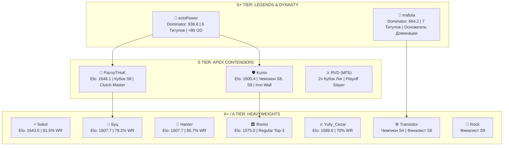

# 🏆 Мастер-таблица и аналитический дашборд: Kunio-kun no Nekketsu Soccer League (Goal 3)
**Сообщество:** [NEKKETSU SPORTS TOURNAMENTS](https://vk.ru/nekketsu) | **Платформа:** Famicom / Dendy (Mednafen Netplay, Tournament Hacks)
**Период охвата:** Сезоны 1–9 (2015–2025/2026) | **База матчей:** 414 официальных встреч

---

## 📌 Раздел 1. Блок инсайтов: «Главное»

> [!IMPORTANT]
> ### Ключевые аналитические инсайты киберспортивной сцены Goal 3:
> 1. **Абсолютный Доминатор — ectoPower (Dominator Score: 938.8):**
>    - Самый титулованный и доминирующий игрок в истории дисциплины (4 чемпионских титула Высшей лиги, 2 Кубка лиг, 9 выходов в финал).
>    - Лидер по абсолютному числу побед (**40 побед**) и лучшей разнице мячей (**+86**, 215 забито против 129 пропущенных).
>    - В 9-м сезоне оформил один из самых доминантных финалов в истории плей-офф, разгромив финалиста Rock со счётом **5:0**.
> 2. **Главная историческая дуэль и смена эпох (mafuta vs ectoPower):**
>    - Первые 4 сезона ознаменовались эпохой абсолютной гегемонии **mafuta** (3 чемпионства подряд и 4 Кубка Лиг). Начиная с 5-го сезона инициативу перехватил **ectoPower**, создавший вторую великую династию.
> 3. **«Клатч-машина» и гроза фаворитов — PacnyTHuK (Elo 1648.1):**
>    - Текущий лидер рейтинга Elo. PacnyTHuK обладает выдающимся коэффициентом побед в ключевых сериях (**70.4% побед**). В грандиозном финале 8-го сезона именно он остановил победное шествие ectoPower в драматичной серии из 8 матчей (**5:3**).
> 4. **«Железная стена» лиги — Kunio (Elo 1600.4, Чемпион 8 и 9 сезонов):**
>    - Обладатель самого строгого оборонительного стиля в истории турнира (всего **1.76 пропущенных гола за матч** — абсолютно лучший показатель среди игроков с 30+ матчами). Именно за счёт железобетонной дисциплины Kunio завоевал золото регулярного чемпионата Высшей лиги 9-го сезона (28 очков).
> 5. **Кубковый киллер — RVD / МГБ (2 Кубка Лиг):**
>    - Уникальный феномен сообщества: уступая фаворитам в затяжных круговых таблицах, RVD трансформируется в неудержимого кубкового хищника на вылет (обладатель Кубка 5-го и 7-го сезонов, где выбивал mafuta и ectoPower).
> 6. **Тёмные лошадки и феномены дивизионов:**
>    - **Sokol (Elo 1643.5, 81.5% побед):** Невероятный винрейт (22 победы в 27 матчах), совершивший стремительный взлёт из Дворовой лиги в элиту.
>    - **Hanter (Elo 1607.7, 85.7% побед):** Абсолютный триумфатор Дворовой лиги 9-го сезона с гроссмейстерским показателем побед.
>    - **Буц (Elo 1607.7, +43 GD):** Бескомпромиссный атакующий стиль с 79.2% побед.

---

## 📊 Раздел 2. Мастер-таблица: Глобальный Elo-рейтинг и игровая статистика

*Рейтинг рассчитан по международной математической модели Elo (FIDE/Esports standard) с учетом коэффициента важности матчей (K=32 для плей-офф, K=24 для регулярки) и весов овертаймов/буллитов.*

| № | Игрок | Статус / Тир | Матчи (GP) | В (W) | П (L) | Винрейт | Забито (GF) | Пропущено (GA) | Разница (GD) | GPG | Сухие матчи | Elo | Пик Elo | Dominator Score |
|:---|:---|:---|:---:|:---:|:---:|:---:|:---:|:---:|:---:|:---:|:---:|:---:|:---:|:---:|
| 1 | **PacnyTHuK** | Tier S (Clutch Giant) | 27 | 19 | 8 | 70.4% | 76 | 46 | +30 | 2.81 | 5 | **1648.1** | 1656.4 | 545.9 |
| 2 | **Sokol** | Tier A+ (Phenom) | 27 | 22 | 5 | 81.5% | 73 | 37 | +36 | 2.70 | 6 | **1643.5** | 1699.8 | 557.4 |
| 3 | **Hanter** | Tier A (Div. Conqueror) | 14 | 12 | 2 | 85.7% | 34 | 16 | +18 | 2.43 | 5 | **1607.7** | 1629.9 | 504.6 |
| 4 | **Буц** | Tier A (Heavyweight) | 24 | 19 | 5 | 79.2% | 85 | 42 | +43 | 3.54 | 4 | **1607.7** | 1636.6 | 473.1 |
| 5 | **ectoPower** | Tier S+ (The GOAT) | 59 | 40 | 19 | 67.8% | 215 | 129 | +86 | 3.64 | 9 | **1602.8** | 1718.3 | **938.8** |
| 6 | **Kunio** | Tier S (Iron Wall) | 37 | 23 | 14 | 62.2% | 87 | 65 | +22 | 2.35 | 5 | **1600.4** | 1660.4 | 540.3 |
| 7 | **Yuliy_Cezar** | Tier A (Rising Force) | 30 | 21 | 9 | 70.0% | 77 | 54 | +23 | 2.57 | 6 | **1589.6** | 1612.4 | 443.0 |
| 8 | **Romix** | Tier A (Iron Contender) | 30 | 19 | 11 | 63.3% | 86 | 67 | +19 | 2.87 | 4 | **1575.0** | 1631.5 | 358.9 |
| 9 | **Transistor** | Tier A+ (Champion) | 13 | 7 | 6 | 53.8% | 46 | 43 | +3 | 3.54 | 1 | **1557.8** | 1582.3 | 382.0 |
| 10 | **Cyneprepou4uk** | Tier B+ (Contender) | 17 | 10 | 7 | 58.8% | 58 | 59 | -1 | 3.41 | 1 | **1537.6** | 1554.2 | 277.2 |
| 11 | **Ryumaru** | Tier B+ (Contender) | 15 | 9 | 6 | 60.0% | 23 | 20 | +3 | 1.53 | 4 | **1527.4** | 1548.9 | 258.8 |
| 12 | **Сахарок** | Tier B (Player) | 12 | 7 | 5 | 58.3% | 29 | 25 | +4 | 2.42 | 2 | **1524.0** | 1538.1 | 247.4 |
| 13 | **mafuta** | Tier S+ (Dynasty King) | 12 | 6 | 6 | 50.0% | 44 | 45 | -1 | 3.67 | 1 | **1519.2** | 1580.4 | 664.2 |
| 14 | **Kubik** | Tier B (Core Veteran) | 28 | 15 | 13 | 53.6% | 76 | 65 | +11 | 2.71 | 1 | **1511.4** | 1545.1 | 229.5 |
| 15 | **ruby** | Tier B (Player) | 13 | 6 | 7 | 46.2% | 25 | 22 | +3 | 1.92 | 2 | **1509.1** | 1528.0 | 188.3 |
| 16 | **Dune** | Tier B (Division Veteran) | 27 | 13 | 14 | 48.1% | 61 | 68 | -7 | 2.26 | 0 | **1501.1** | 1530.8 | 173.2 |
| 17 | **K-R** | Tier B (Tactician) | 10 | 5 | 5 | 50.0% | 23 | 18 | +5 | 2.30 | 0 | **1498.2** | 1515.6 | 178.6 |
| 18 | **Rock** | Tier A (Finalist) | 18 | 7 | 11 | 38.9% | 34 | 54 | -20 | 1.89 | 1 | **1489.2** | 1525.0 | 140.2 |
| 19 | **Ric25** | Tier A- (Mainstay) | 24 | 10 | 14 | 41.7% | 54 | 57 | -3 | 2.25 | 3 | **1482.0** | 1531.0 | 128.8 |
| 20 | **Aeris** | Tier B+ (Veteran) | 32 | 12 | 20 | 37.5% | 78 | 88 | -10 | 2.44 | 1 | **1480.3** | 1514.8 | 108.6 |
| 21 | **frzz** | Tier B (Mid-Tier) | 26 | 12 | 14 | 46.2% | 54 | 56 | -2 | 2.08 | 1 | **1475.5** | 1512.2 | 137.9 |
| 22 | **RASH** | Tier B (Player) | 16 | 7 | 9 | 43.8% | 40 | 46 | -6 | 2.50 | 1 | **1475.5** | 1500.0 | 123.6 |
| 23 | **E_not** | Tier B (Player) | 20 | 8 | 12 | 40.0% | 44 | 52 | -8 | 2.20 | 2 | **1469.4** | 1500.0 | 97.4 |
| 24 | **yoxter** | Tier B (Veteran) | 32 | 11 | 21 | 34.4% | 50 | 73 | -23 | 1.56 | 4 | **1467.8** | 1500.0 | 70.6 |
| 25 | **Taeda** | Tier B (Player) | 27 | 9 | 18 | 33.3% | 37 | 51 | -14 | 1.37 | 3 | **1463.5** | 1500.0 | 70.2 |
| 26 | **Jamlight** | Tier B+ (Div. Champ) | 30 | 13 | 17 | 43.3% | 74 | 88 | -14 | 2.47 | 3 | **1460.3** | 1506.0 | 124.9 |
| 27 | **RVD (МГБ)** | Tier S (Playoff Slayer) | 26 | 10 | 16 | 38.5% | 88 | 102 | -14 | 3.38 | 0 | **1455.5** | 1540.0 | 240.2 |
| 28 | **Веселый Роджер** | Tier C (Amateur) | 12 | 4 | 8 | 33.3% | 15 | 27 | -12 | 1.25 | 2 | **1453.6** | 1500.0 | 56.4 |
| 29 | **leonudomlya** | Tier B+ (Veteran) | 30 | 9 | 21 | 30.0% | 49 | 89 | -40 | 1.63 | 1 | **1423.6** | 1500.0 | 13.9 |
| 30 | **Memori** | Tier B (Organizer) | 29 | 5 | 24 | 17.2% | 42 | 96 | -54 | 1.45 | 1 | **1380.5** | 1500.0 | -132.8 |
| 31 | **Кирпич57** | Tier C (Hardcore Fan) | 28 | 4 | 24 | 14.3% | 48 | 104 | -56 | 1.71 | 0 | **1320.4** | 1500.0 | -236.4 |

---

## 🥊 Раздел 3. Матрица личных встреч (Head-to-Head Top-Tier)

*Таблица показывает баланс побед и поражений (счёт по голам) между ключевыми фигурами сцены:*

| Игрок | ectoPower | PacnyTHuK | Kunio | Romix | mafuta | Sokol | Буц | Yuliy_Cezar | Rock | Ric25 |
|:---|:---:|:---:|:---:|:---:|:---:|:---:|:---:|:---:|:---:|:---:|
| **ectoPower** | — | **4 - 5** (18:22) | **2 - 1** (6:3) | **6 - 3** (33:23) | **1 - 1** (5:5) | — | — | — | **7 - 0** (36:11) | **3 - 0** (11:5) |
| **PacnyTHuK** | **5 - 4** (22:18) | — | **4 - 2** (15:10) | — | — | — | **1 - 0** (4:1) | — | — | — |
| **Kunio** | **1 - 2** (3:6) | **2 - 4** (10:15) | — | — | — | **4 - 1** (14:6) | — | — | **3 - 2** (9:8) | **4 - 0** (9:3) |
| **Romix** | **3 - 6** (23:33) | — | — | — | — | — | — | — | **2 - 1** (12:8) | — |
| **mafuta** | **1 - 1** (5:5) | — | — | — | — | — | — | — | — | — |
| **Sokol** | — | — | **1 - 4** (6:14) | — | — | — | — | — | — | **3 - 0** (11:5) |
| **Буц** | — | **0 - 1** (1:4) | — | — | — | — | — | — | — | — |
| **Yuliy_Cezar** | — | — | — | — | — | — | — | — | — | — |
| **Rock** | **0 - 7** (11:36) | — | **2 - 3** (8:9) | **1 - 2** (8:12) | — | — | — | — | — | **2 - 2** (6:7) |
| **Ric25** | **0 - 3** (5:11) | — | **0 - 4** (3:9) | — | — | **0 - 3** (5:11) | — | — | **2 - 2** (7:6) | — |

---

## 🏛️ Раздел 4. Зал Славы и Хроника Чемпионов (Seasons 1–9)

| Сезон | Год | Чемпион Высшей лиги | Обладатель Кубка лиг | Финалист Кубка / Вице-чемпион | Бронзовый призёр |
|:---:|:---:|:---|:---|:---|:---|
| **Сезон 1** | 2015 | **mafuta** | **mafuta** | — | — |
| **Сезон 2** | 2016 | **mafuta** | **mafuta** | ectoPower | — |
| **Сезон 3** | 2016 | **mafuta** | **mafuta** | ectoPower | Ric25 |
| **Сезон 4** | 2017 | **Transistor** | **mafuta** | Transistor | ectoPower |
| **Сезон 5** | 2017 | **ectoPower** | **RVD (МГБ)** | PacnyTHuK (5:2) | mafuta / izzzotope |
| **Сезон 6** | 2018 | **ectoPower** | **ectoPower** | Transistor (5:4 в 9 играх) | Rock / Memori |
| **Сезон 7** | 2022 | **ectoPower** | **RVD (МГБ)** | mafuta / ectoPower | Romix |
| **Сезон 8** | 2024 | **Kunio** / **ectoPower** | **PacnyTHuK** | ectoPower (5:3 в 8 играх) | Romix / Kunio |
| **Сезон 9** | 2025 | **Kunio** | **ectoPower** | Rock (5:0 в финале) | Romix |

---

## 🎖️ Раздел 5. Иерархия доминаторов и архетипы игроков

